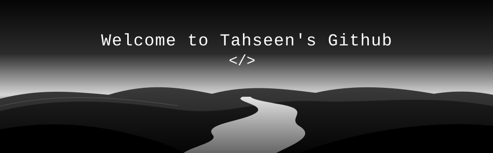

 

 

<h2 align="center"> About me</h2>

<table align="center">
<tr>
<td width="62%" valign="middle">

Hello there! I'm **Tahseen**, a backend focused Full Stack Developer who enjoys building real world applications and solving problems on LeetCode. I work with technologies like Node.js, Express.js, React, Redis, BullMQ, MongoDB, and PostgreSQL to build practical applications and improve my development skills.

</td>
<td width="38%" align="center" valign="middle">

</td>
</tr>
</table>

**🎓 B.Tech in Computer Science & Engineering** 
**💼 Former Full Stack Developer Intern at Texura** 
**🏅 Diploma in CSE Branch Topper** 
**💻 350+ DSA Problems Solved**

 

<h2 align="center"> Technologies</h2>

 

 

 

<h2 align="center"> Statistics</h2>

  
  

  

